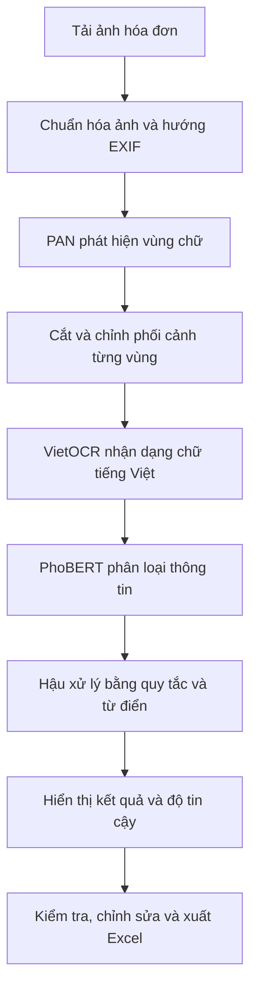

# Invoice OCR

Hệ thống đọc hóa đơn tiếng Việt, sử dụng PAN để phát hiện vùng chữ, VietOCR để nhận dạng chữ và PhoBERT để phân loại thông tin.

Demo hỗ trợ tải ảnh hóa đơn, trích xuất tên cửa hàng, địa chỉ, thời gian và tổng tiền; chỉnh sửa kết quả và xuất Excel.

## Workflow



1. Người dùng tải ảnh lên giao diện; backend chuẩn hóa ảnh và tạo tác vụ xử lý.
2. PAN xác định các vùng chữ, sau đó hệ thống cắt và chỉnh phối cảnh từng vùng.
3. VietOCR đọc nội dung chữ; PhoBERT phân loại thành `SELLER`, `ADDRESS`, `TIMESTAMP`, `TOTAL_COST`.
4. Các quy tắc, từ điển và vị trí vùng chữ hỗ trợ tổng hợp tên cửa hàng, địa chỉ, ngày giờ và tổng tiền.
5. Giao diện hiển thị vùng chữ, thông tin trích xuất và độ tin cậy. Người dùng kiểm tra, chỉnh sửa rồi xuất Excel; lịch sử xử lý được lưu cục bộ.

## Cấu trúc thư mục

- `data/`: dữ liệu ảnh, nhãn, CSV và từ điển.
- `invoice_demo/`: backend FastAPI, frontend và mã mô hình.
- `notebooks/`: notebook thử nghiệm và đánh giá.
- `configs/`: cấu hình mô hình.
- `weights/`: trọng số mô hình, lưu bằng Git LFS.
- `metrics/`: kết quả đánh giá.
- `tools/`: công cụ hỗ trợ.
- `tests/`: kiểm thử ứng dụng.

## Cài đặt và chạy

Cần Python 3.12 và Git LFS. Chạy các lệnh sau trong PowerShell:

```powershell
git lfs install
git clone https://github.com/TPhAnh7105/Invoice_OCR.git
cd Invoice_OCR
git lfs pull
python -m venv .venv
.venv\Scripts\python.exe -m pip install -r requirements-demo.txt
$env:OCR_ALLOW_DOWNLOAD = "1"
.venv\Scripts\python.exe run_demo.py
```

Mở **http://127.0.0.1:8000** để sử dụng. Lần đầu cần Internet để tải cấu hình và tokenizer PhoBERT. Hệ thống tự dùng GPU CUDA nếu có, hoặc CPU.

Các lần sau có thể chạy `start_demo.cmd`. Kết quả và lịch sử xử lý được lưu trong `output/fastapi_demo/`.

## Notebook

Mở `notebooks/invoice-ocr-with-metrics.ipynb` bằng Jupyter hoặc VS Code và chọn môi trường Python đã cài các thư viện cần thiết. Notebook đọc dữ liệu từ `data/`.
